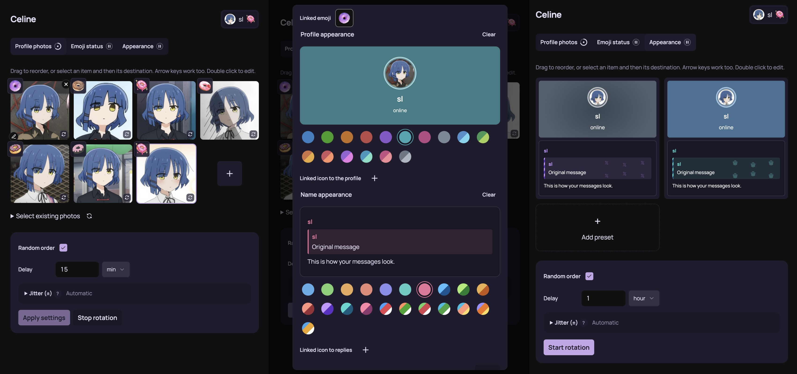

# Celine

Update your telegram profile automatically on schedule. Configure presets, update image / status / style together or on separate schedules.



## Features

- Rotation for profile pictures
- Rotation for statuss
- Rotation for profile / message style
- Link status / style to the profile picture to rotate it together, allowing for matching status / style
- Edit / crop pictures
- Change order or rotate randomly
- Configure custom jitter between rotations
- Reuse already uploaded pictures and continue rotation where last left off

## Get started

Download and run the binary for your platform from [Releases](../../releases).

## Run with Nix

```sh
nix run github:sleroq/celine
```
